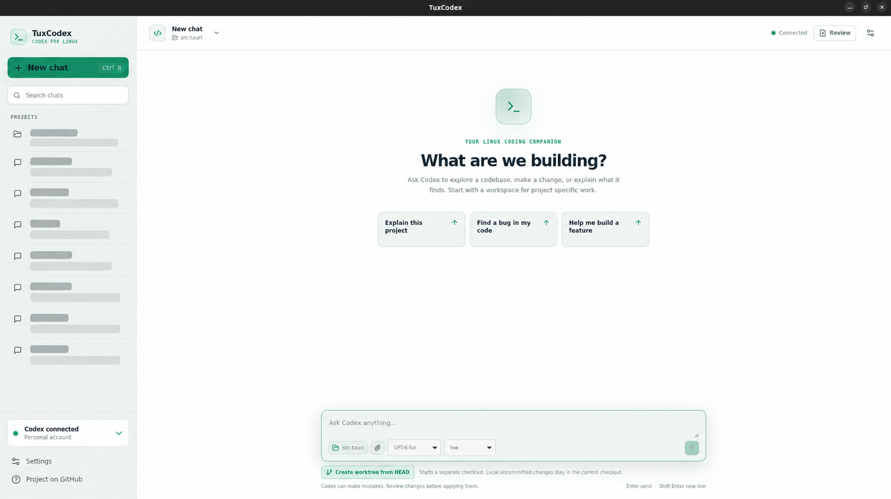

# TuxCodex


**A desktop workspace for OpenAI Codex on Linux, Windows, and macOS.**

TuxCodex puts project switching, Codex chats, streamed work, approvals, code review, and file previews in one window. It connects to the Codex CLI installed on your computer and uses your existing Codex sign-in. Built with Tauri, React, and Rust, TuxCodex is an independent, unofficial project. The Ubuntu desktop experience has been tested; Windows and macOS installers remain previews.



## Download

Get the latest installers from [GitHub Releases](https://github.com/MoussaKassim/TuxCodex/releases). Version 0.1.0 is a preview release.

| Platform | Download |
| --- | --- |
| Ubuntu / Debian (x86-64) | `.deb` |
| Fedora (x86-64) | `.rpm` |
| Windows (x64) | `-setup.exe` |
| macOS (Apple silicon / Intel) | `.dmg` |

The installers are not code signed or notarized yet, so Windows or macOS may display a warning. Each release includes `SHA256SUMS.txt` for checking downloads.
The next tagged release is planned to include separate Ubuntu 22.04 and 24.04 packages. Version 0.1.0 predates that split.

## Get started

1. Install the [official Codex CLI](https://github.com/openai/codex) and sign in:

   ```bash
   npm install -g @openai/codex
   codex login
   ```

2. Download and install the TuxCodex package for your operating system from [Releases](https://github.com/MoussaKassim/TuxCodex/releases).
3. Open TuxCodex, choose a project folder, and start a chat.

TuxCodex uses your existing Codex sign-in and configuration. The CLI is a separate prerequisite and is not bundled with the app. If TuxCodex cannot find it, set the full path to `codex` in Settings or through `TUXCODEX_CODEX_BIN`.

## What you can do

- **Work across projects and chats:** choose a folder, create or resume chats, search titles and paths, and archive conversations.
- **Follow Codex as it works:** see streamed replies, command output, file changes, and plan updates; interrupt a turn when needed.
- **Review changes:** inspect Git changes in the review panel and ask Codex to review uncommitted work.
- **Use separate worktrees:** start a chat in a new Git worktree based on the current `HEAD`. Uncommitted and ignored files stay in the original checkout.
- **Control approvals:** accept or decline requests to run commands or change files. Full Access requires explicit confirmation.
- **Choose a model and reasoning effort:** use the options reported by your installed Codex CLI.
- **Attach and preview files:** send supported images or audio, record voice input, and preview workspace files including images, PDFs, HTML, and text. Generated images and image paths in replies appear inline and open in the larger viewer.
- **Make it yours:** switch themes and customize the wallpaper.

Feature availability can depend on the installed Codex CLI, selected model, and operating system.
Audio input requires a compatible Codex app-server: CLI 0.143.0 rejects `localAudio`, while 0.162.1 accepts the input shape. If the server rejects an audio turn, TuxCodex restores the draft and attachments. Actual audio processing still needs an authenticated desktop test.

## Build from source

Install Node.js, npm, Rust, and the [Tauri 2 prerequisites](https://v2.tauri.app/start/prerequisites/) for your operating system. On Ubuntu or Debian:

```bash
sudo apt update
sudo apt install libwebkit2gtk-4.1-dev build-essential curl wget file \
  libxdo-dev libssl-dev libayatana-appindicator3-dev librsvg2-dev
```

Then run:

```bash
git clone https://github.com/MoussaKassim/TuxCodex.git
cd TuxCodex
npm ci
npm run tauri dev
```

Use `npm run tauri build -- --bundles deb` on Ubuntu/Debian, or replace `deb` with `rpm`, `nsis`, or `dmg` on the matching platform. `npm run dev` opens a browser preview with sample data; the desktop app is needed to connect to Codex.

## How it works

```text
React + TypeScript interface
          │ Tauri commands and events
          ▼
      Rust bridge
          │ JSON lines over standard input/output
          ▼
 codex app-server (local Codex CLI)
```

TuxCodex starts `codex app-server` in the background and displays its responses and approval requests. Codex manages authentication and chat history. The [official App Server documentation](https://learn.chatgpt.com/docs/app-server) describes the protocol.
App-server versions differ in how they spell permission values. TuxCodex retries with the older enum spelling only when the server rejects the newer one.

## Development

```bash
npm test
npm run test:coverage
npm run test:app-server
npm run build
cargo test --manifest-path src-tauri/Cargo.toml
```

`test:app-server` needs an installed `codex` CLI on `PATH`; use `TUXCODEX_TEST_CODEX_BIN` to select another executable. The test uses a temporary Codex home and workspace without starting an inference turn.

GitHub Actions runs frontend and Rust tests, checks the app-server protocol against an older and a current CLI, uploads JUnit reports and Ubuntu coverage, and builds installers for Ubuntu 22.04, Ubuntu 24.04, Fedora, Windows, and macOS. The Linux jobs check that the packaged app opens a visible window under Xvfb and upload startup time and launcher memory samples. Version tags publish installers only after the required jobs pass. Interactive testing on each platform is still valuable. Contributions and bug reports are welcome through [Issues](https://github.com/MoussaKassim/TuxCodex/issues).

## Authors

TuxCodex is developed by **Moussa Kassim Mohame** and **Stefano Cacciatore**. The [Git history](https://github.com/MoussaKassim/TuxCodex/commits/main/) records contributions to the project.

TuxCodex is an unofficial client and is not affiliated with OpenAI.

## License

[MIT](LICENSE).
